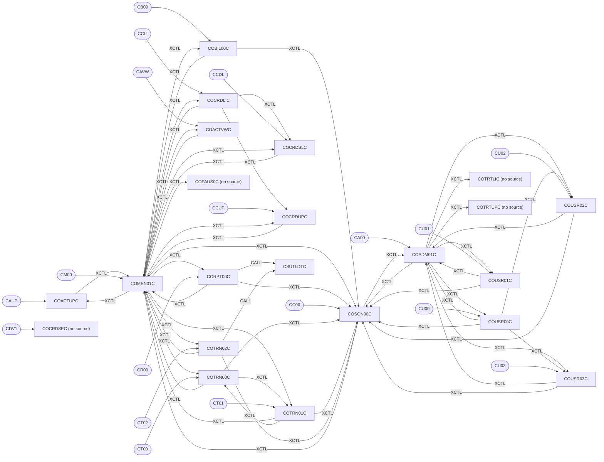
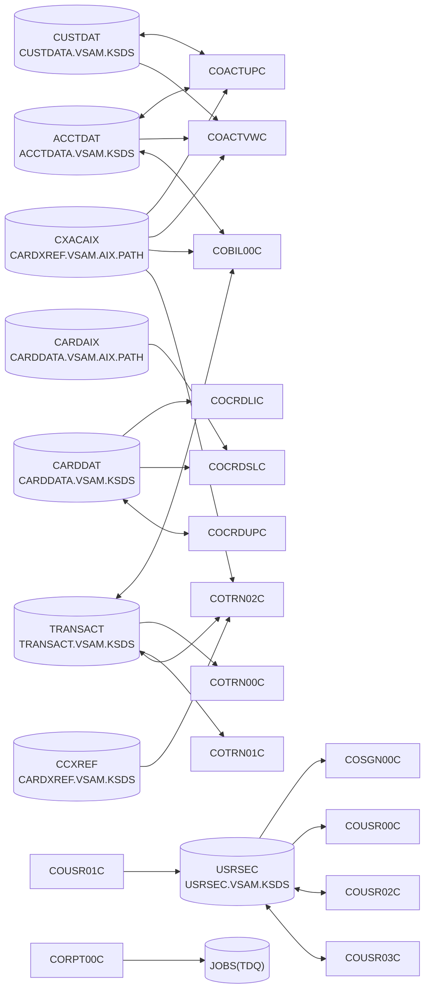

# CardDemo dependency graph

Generated by `tools/inventory` from the reference clone at commit `59cc6c2fd7ebd7ef7925cad552a01a4b8b6e4d5e`. Do not edit by hand.

Scope: the base application under `app/` (the optional `app/app-*` modules are excluded).
Every node and edge is listed with its source `path:line` in `inventory-evidence.csv`.
Language Environment services (`CEE*`) are left out of the diagrams.

## Online: transactions and program flow

Rounded nodes are CICS transaction IDs (from the CSD). Edges are `EXEC CICS XCTL`/`LINK` and `CALL` targets.

## Online: data access

Cylinders are CICS files (with dataset) and queues. Arrows point from a store a program reads to the program, and from a program to a store it writes; `<-->` is both.

## Batch: jobs, programs and datasets

Hexagons are JCL or procedure members with an `EXEC PGM=` step for the program. Cylinders are datasets named on the step's DD statements (generation numbers dropped). Arrow direction follows the `OPEN` mode.

```mermaid
flowchart LR
    J_app_jcl_CBEXPORT_jcl{{"app/jcl/CBEXPORT.jcl"}}
    J_app_jcl_CBIMPORT_jcl{{"app/jcl/CBIMPORT.jcl"}}
    J_app_jcl_CREASTMT_JCL{{"app/jcl/CREASTMT.JCL"}}
    J_app_jcl_INTCALC_jcl{{"app/jcl/INTCALC.jcl"}}
    J_app_jcl_POSTTRAN_jcl{{"app/jcl/POSTTRAN.jcl"}}
    J_app_jcl_READACCT_jcl{{"app/jcl/READACCT.jcl"}}
    J_app_jcl_READCARD_jcl{{"app/jcl/READCARD.jcl"}}
    J_app_jcl_READCUST_jcl{{"app/jcl/READCUST.jcl"}}
    J_app_jcl_READXREF_jcl{{"app/jcl/READXREF.jcl"}}
    J_app_jcl_TRANREPT_jcl{{"app/jcl/TRANREPT.jcl"}}
    J_app_jcl_WAITSTEP_jcl{{"app/jcl/WAITSTEP.jcl"}}
    J_app_proc_TRANREPT_prc{{"app/proc/TRANREPT.prc"}}
    P_CBACT01C["CBACT01C"]
    P_CBACT02C["CBACT02C"]
    P_CBACT03C["CBACT03C"]
    P_CBACT04C["CBACT04C"]
    P_CBCUS01C["CBCUS01C"]
    P_CBEXPORT["CBEXPORT"]
    P_CBIMPORT["CBIMPORT"]
    P_CBSTM03A["CBSTM03A"]
    P_CBSTM03B["CBSTM03B"]
    P_CBTRN01C["CBTRN01C"]
    P_CBTRN02C["CBTRN02C"]
    P_CBTRN03C["CBTRN03C"]
    P_COBDATFT["COBDATFT"]
    P_COBSWAIT["COBSWAIT"]
    P_MVSWAIT["MVSWAIT"]
    D_AWS_M2_CARDDEMO_ACCTDATA_ARRYPS[("ACCTDATA.ARRYPS")]
    D_AWS_M2_CARDDEMO_ACCTDATA_IMPORT[("ACCTDATA.IMPORT")]
    D_AWS_M2_CARDDEMO_ACCTDATA_PSCOMP[("ACCTDATA.PSCOMP")]
    D_AWS_M2_CARDDEMO_ACCTDATA_VBPS[("ACCTDATA.VBPS")]
    D_AWS_M2_CARDDEMO_ACCTDATA_VSAM_KSDS[("ACCTDATA.VSAM.KSDS")]
    D_AWS_M2_CARDDEMO_CARDDATA_VSAM_KSDS[("CARDDATA.VSAM.KSDS")]
    D_AWS_M2_CARDDEMO_CARDXREF_IMPORT[("CARDXREF.IMPORT")]
    D_AWS_M2_CARDDEMO_CARDXREF_VSAM_KSDS[("CARDXREF.VSAM.KSDS")]
    D_AWS_M2_CARDDEMO_CUSTDATA_IMPORT[("CUSTDATA.IMPORT")]
    D_AWS_M2_CARDDEMO_CUSTDATA_VSAM_KSDS[("CUSTDATA.VSAM.KSDS")]
    D_AWS_M2_CARDDEMO_DALYREJS[("DALYREJS")]
    D_AWS_M2_CARDDEMO_DALYTRAN_PS[("DALYTRAN.PS")]
    D_AWS_M2_CARDDEMO_DATEPARM[("DATEPARM")]
    D_AWS_M2_CARDDEMO_DISCGRP_VSAM_KSDS[("DISCGRP.VSAM.KSDS")]
    D_AWS_M2_CARDDEMO_EXPORT_DATA[("EXPORT.DATA")]
    D_AWS_M2_CARDDEMO_IMPORT_ERRORS[("IMPORT.ERRORS")]
    D_AWS_M2_CARDDEMO_STATEMNT_HTML[("STATEMNT.HTML")]
    D_AWS_M2_CARDDEMO_STATEMNT_PS[("STATEMNT.PS")]
    D_AWS_M2_CARDDEMO_SYSTRAN[("SYSTRAN")]
    D_AWS_M2_CARDDEMO_TCATBALF_VSAM_KSDS[("TCATBALF.VSAM.KSDS")]
    D_AWS_M2_CARDDEMO_TRANCATG_VSAM_KSDS[("TRANCATG.VSAM.KSDS")]
    D_AWS_M2_CARDDEMO_TRANREPT[("TRANREPT")]
    D_AWS_M2_CARDDEMO_TRANSACT_DALY[("TRANSACT.DALY")]
    D_AWS_M2_CARDDEMO_TRANSACT_IMPORT[("TRANSACT.IMPORT")]
    D_AWS_M2_CARDDEMO_TRANSACT_VSAM_KSDS[("TRANSACT.VSAM.KSDS")]
    D_AWS_M2_CARDDEMO_TRANTYPE_VSAM_KSDS[("TRANTYPE.VSAM.KSDS")]
    D_AWS_M2_CARDDEMO_TRXFL_VSAM_KSDS[("TRXFL.VSAM.KSDS")]
    D_DD_ACCTFILE[("DD ACCTFILE")]
    D_DD_CARDFILE[("DD CARDFILE")]
    D_DD_CARDOUT[("DD CARDOUT")]
    D_DD_CUSTFILE[("DD CUSTFILE")]
    D_DD_DALYTRAN[("DD DALYTRAN")]
    D_DD_TRANFILE[("DD TRANFILE")]
    D_DD_XREFFILE[("DD XREFFILE")]
    J_app_jcl_READACCT_jcl --> P_CBACT01C
    P_CBACT01C -->|CALL| P_COBDATFT
    D_AWS_M2_CARDDEMO_ACCTDATA_VSAM_KSDS --> P_CBACT01C
    P_CBACT01C --> D_AWS_M2_CARDDEMO_ACCTDATA_ARRYPS
    P_CBACT01C --> D_AWS_M2_CARDDEMO_ACCTDATA_PSCOMP
    P_CBACT01C --> D_AWS_M2_CARDDEMO_ACCTDATA_VBPS
    J_app_jcl_READCARD_jcl --> P_CBACT02C
    D_AWS_M2_CARDDEMO_CARDDATA_VSAM_KSDS --> P_CBACT02C
    J_app_jcl_READXREF_jcl --> P_CBACT03C
    D_AWS_M2_CARDDEMO_CARDXREF_VSAM_KSDS --> P_CBACT03C
    J_app_jcl_INTCALC_jcl --> P_CBACT04C
    D_AWS_M2_CARDDEMO_ACCTDATA_VSAM_KSDS <--> P_CBACT04C
    D_AWS_M2_CARDDEMO_DISCGRP_VSAM_KSDS --> P_CBACT04C
    D_AWS_M2_CARDDEMO_TCATBALF_VSAM_KSDS --> P_CBACT04C
    P_CBACT04C --> D_AWS_M2_CARDDEMO_SYSTRAN
    D_AWS_M2_CARDDEMO_CARDXREF_VSAM_KSDS --> P_CBACT04C
    J_app_jcl_READCUST_jcl --> P_CBCUS01C
    D_AWS_M2_CARDDEMO_CUSTDATA_VSAM_KSDS --> P_CBCUS01C
    J_app_jcl_CBEXPORT_jcl --> P_CBEXPORT
    D_AWS_M2_CARDDEMO_ACCTDATA_VSAM_KSDS --> P_CBEXPORT
    D_AWS_M2_CARDDEMO_CARDDATA_VSAM_KSDS --> P_CBEXPORT
    D_AWS_M2_CARDDEMO_CUSTDATA_VSAM_KSDS --> P_CBEXPORT
    P_CBEXPORT --> D_AWS_M2_CARDDEMO_EXPORT_DATA
    D_AWS_M2_CARDDEMO_TRANSACT_VSAM_KSDS --> P_CBEXPORT
    D_AWS_M2_CARDDEMO_CARDXREF_VSAM_KSDS --> P_CBEXPORT
    J_app_jcl_CBIMPORT_jcl --> P_CBIMPORT
    P_CBIMPORT --> D_AWS_M2_CARDDEMO_ACCTDATA_IMPORT
    P_CBIMPORT --> D_DD_CARDOUT
    P_CBIMPORT --> D_AWS_M2_CARDDEMO_CUSTDATA_IMPORT
    P_CBIMPORT --> D_AWS_M2_CARDDEMO_IMPORT_ERRORS
    D_AWS_M2_CARDDEMO_EXPORT_DATA --> P_CBIMPORT
    P_CBIMPORT --> D_AWS_M2_CARDDEMO_TRANSACT_IMPORT
    P_CBIMPORT --> D_AWS_M2_CARDDEMO_CARDXREF_IMPORT
    J_app_jcl_CREASTMT_JCL --> P_CBSTM03A
    P_CBSTM03A -->|CALL| P_CBSTM03B
    P_CBSTM03A --> D_AWS_M2_CARDDEMO_STATEMNT_HTML
    P_CBSTM03A --> D_AWS_M2_CARDDEMO_STATEMNT_PS
    D_AWS_M2_CARDDEMO_ACCTDATA_VSAM_KSDS --> P_CBSTM03B
    D_AWS_M2_CARDDEMO_CUSTDATA_VSAM_KSDS --> P_CBSTM03B
    D_AWS_M2_CARDDEMO_TRXFL_VSAM_KSDS --> P_CBSTM03B
    D_AWS_M2_CARDDEMO_CARDXREF_VSAM_KSDS --> P_CBSTM03B
    D_DD_ACCTFILE --> P_CBTRN01C
    D_DD_CARDFILE --> P_CBTRN01C
    D_DD_CUSTFILE --> P_CBTRN01C
    D_DD_DALYTRAN --> P_CBTRN01C
    D_DD_TRANFILE --> P_CBTRN01C
    D_DD_XREFFILE --> P_CBTRN01C
    J_app_jcl_POSTTRAN_jcl --> P_CBTRN02C
    D_AWS_M2_CARDDEMO_ACCTDATA_VSAM_KSDS <--> P_CBTRN02C
    P_CBTRN02C --> D_AWS_M2_CARDDEMO_DALYREJS
    D_AWS_M2_CARDDEMO_DALYTRAN_PS --> P_CBTRN02C
    D_AWS_M2_CARDDEMO_TCATBALF_VSAM_KSDS <--> P_CBTRN02C
    P_CBTRN02C --> D_AWS_M2_CARDDEMO_TRANSACT_VSAM_KSDS
    D_AWS_M2_CARDDEMO_CARDXREF_VSAM_KSDS --> P_CBTRN02C
    J_app_jcl_TRANREPT_jcl --> P_CBTRN03C
    J_app_proc_TRANREPT_prc --> P_CBTRN03C
    D_AWS_M2_CARDDEMO_CARDXREF_VSAM_KSDS --> P_CBTRN03C
    D_AWS_M2_CARDDEMO_DATEPARM --> P_CBTRN03C
    D_AWS_M2_CARDDEMO_TRANCATG_VSAM_KSDS --> P_CBTRN03C
    D_AWS_M2_CARDDEMO_TRANSACT_DALY --> P_CBTRN03C
    P_CBTRN03C --> D_AWS_M2_CARDDEMO_TRANREPT
    D_AWS_M2_CARDDEMO_TRANTYPE_VSAM_KSDS --> P_CBTRN03C
    J_app_jcl_WAITSTEP_jcl --> P_COBSWAIT
    P_COBSWAIT -->|CALL| P_MVSWAIT
```

